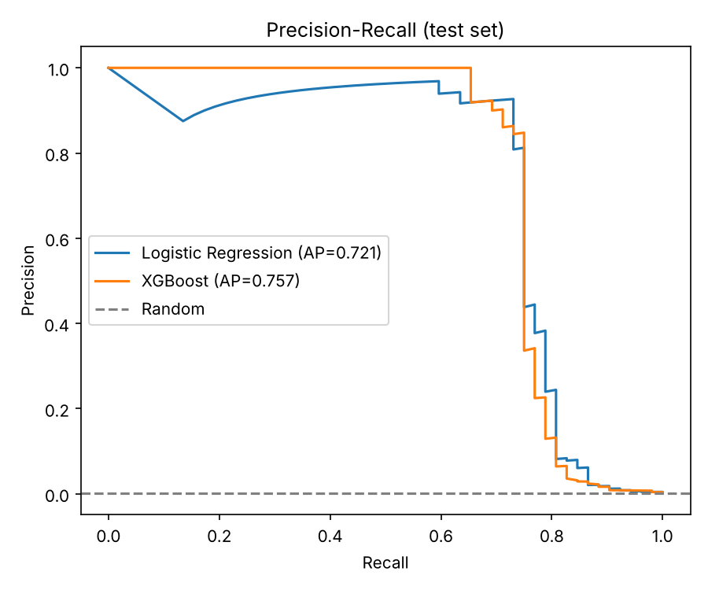
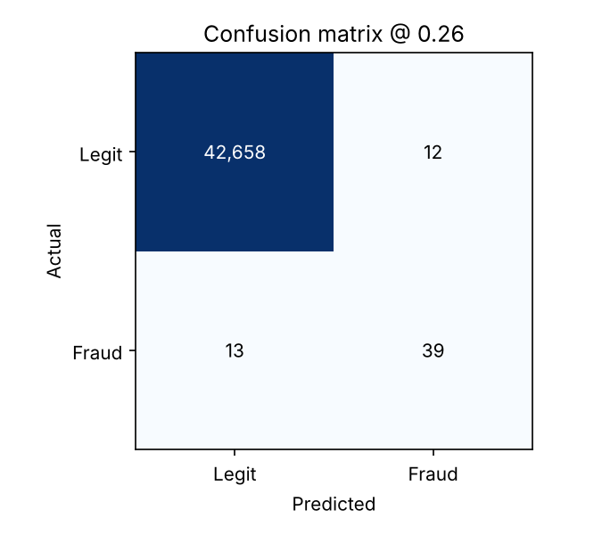

# Credit Card Fraud Detection

Real-time fraud scoring for card transactions: an XGBoost model on the highly imbalanced
[Kaggle / ULB credit card dataset](https://www.kaggle.com/datasets/mlg-ulb/creditcardfraud)
(284,807 transactions, 0.17% fraud), served through a FastAPI endpoint that also explains each decision.

## Why it's built this way
- **Time-based split (70/15/15)**, not random. Fraud patterns drift, so I train on the past and test on the future, like production.
- **PR-AUC, not accuracy.** A model that says "never fraud" is 99.8% accurate. PR-AUC, precision and recall are what matter.
- **Threshold tuned on validation only**: highest recall while keeping precision >= 80%, so analysts aren't flooded with false alarms. Test data is never used for tuning.
- **Baseline vs. model**: Logistic Regression compared against XGBoost.
- **Explainable**: each prediction returns its top 3 contributing features (XGBoost per-prediction contributions).
- Runs fine on a laptop CPU (trains in about a minute).

## Results (held-out future slice, 42,722 transactions, 52 frauds)

| Model | PR-AUC | Precision | Recall | F1 |
|---|---|---|---|---|
| Logistic Regression | 0.721 | 0.844 | 0.731 | 0.784 |
| **XGBoost** | **0.757** | 0.765 | 0.750 | 0.757 |

XGBoost ranks fraud better (higher PR-AUC). Caveat: the test slice has only 52 fraud cases, so the
precision/recall figures are noisy; one or two transactions move them several points.




## Quickstart
```bash
pip install -r requirements.txt
# put creditcard.csv in data/ (download from Kaggle)
make train      # trains, evaluates, saves model + plots to results/
make test
make serve      # http://127.0.0.1:8000/docs
```

Example request:
```bash
curl -X POST localhost:8000/predict -H 'Content-Type: application/json' \
  -d '{"Time": 1000, "Amount": 25.5, "features": {"V1": 0, "V2": 0, ... "V28": 0}}'
```

## Running it step by step
Commands are for macOS and Linux.

**1. Clone the repo**
```bash
git clone https://github.com/sunburnpeell/credit-card-fraud-detection.git
cd credit-card-fraud-detection
```

**2. Set up a virtual environment** (first time only)
```bash
python3 -m venv .venv
source .venv/bin/activate
pip install -r requirements.txt
```

**3. Get the data.** The CSV is about 150 MB, so it isn't in the repo. This is a public mirror of the Kaggle file:
```bash
mkdir -p data
curl -L -o data/creditcard.csv https://storage.googleapis.com/download.tensorflow.org/data/creditcard.csv
```

**4. Train.** Takes about a minute on a laptop CPU.
```bash
make train
```
You should see:
```
train=199,364 val=42,721 test=42,722 | fraud rate train=0.1926% test=0.1217%
Logistic Regression  PR-AUC=0.721 P=0.844 R=0.731 F1=0.784 (TP=38 FP=7 FN=14)
XGBoost              PR-AUC=0.757 P=0.765 R=0.750 F1=0.757 (TP=39 FP=12 FN=13)
Saved model + results.
```
The model goes to `models/xgb_fraud.joblib`, metrics and plots to `results/`.

**5. Test**
```bash
make test        # 4 passed
```

**6. Score your own transactions.** Put them in `input.csv` with an `id` column plus `Time`, `V1`-`V28` and `Amount`. `Class` is optional; if it's there, each prediction gets marked right or wrong.
```
id,Time,V1,V2,...,V28,Amount,Class
F01,155548.0,1.878230031,1.325629574,...,0.005237667,7.06,1
```
Save this as `score.py`:
```python
import pandas as pd
from fastapi.testclient import TestClient
from fraud_detection.api import app

c = TestClient(app)
for _, r in pd.read_csv("input.csv").iterrows():
    j = c.post("/predict", json={"Time": r.Time, "Amount": r.Amount,
               "features": {f"V{i}": r[f"V{i}"] for i in range(1, 29)}}).json()
    ok = ""
    if "Class" in r:
        ok = "right" if int(j["is_fraud"]) == r.Class else "WRONG"
    print(f"{r.id}  p={j['fraud_probability']:.3f}  fraud={j['is_fraud']}  {j['risk_level']:6} {ok}")
```
Then run:
```bash
PYTHONPATH=src python score.py
```
I tried it on 10 frauds and 10 legit transactions from the test slice. It got 18 of 20:
```
F01  p=0.160  fraud=False  medium WRONG
F02  p=0.088  fraud=False  low    WRONG
F03  p=0.517  fraud=True  high   right
...
L10  p=0.085  fraud=False  low    right
```
The two it missed (F01, F02) don't have the strongly negative V14 that most frauds have, so they look normal to the model.

**Reading the output**
- `p` is the fraud score. It isn't calibrated: legit transactions sit around 0.08, so read it as a ranking, not a real probability.
- `fraud` is true when `p` is at or above the threshold (0.258, tuned on validation).
- Risk level is `high` above the threshold, `medium` from half the threshold up, `low` below that.

**Next time**, it's just:
```bash
source .venv/bin/activate
PYTHONPATH=src python score.py
```

## Structure
```
src/fraud_detection/  data.py  evaluate.py  train.py  api.py
tests/                unit + API tests
results/              metrics.json and plots
```

## Next steps
- Cost-based threshold (missed fraud costs more than a false alarm)
- LightGBM / probability calibration, SHAP dashboards
- Drift monitoring and a Docker image
- Try the mobile-money PaySim dataset

*Dataset features V1-V28 are PCA-anonymised, so feature-level interpretation is limited.*
